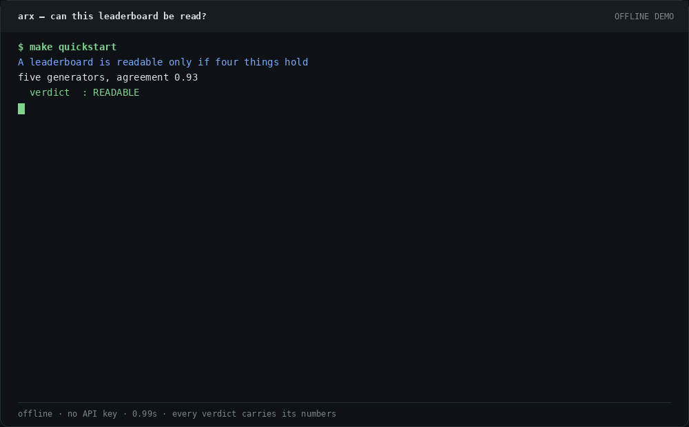
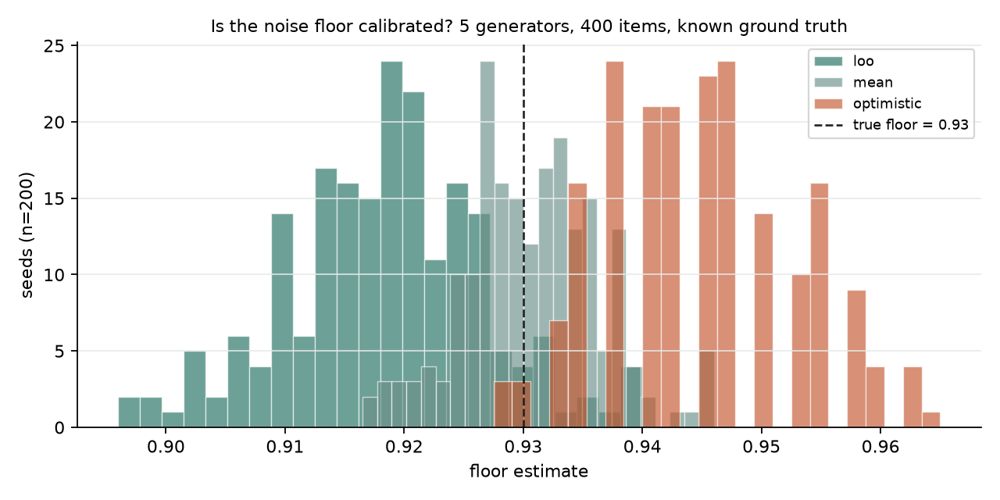
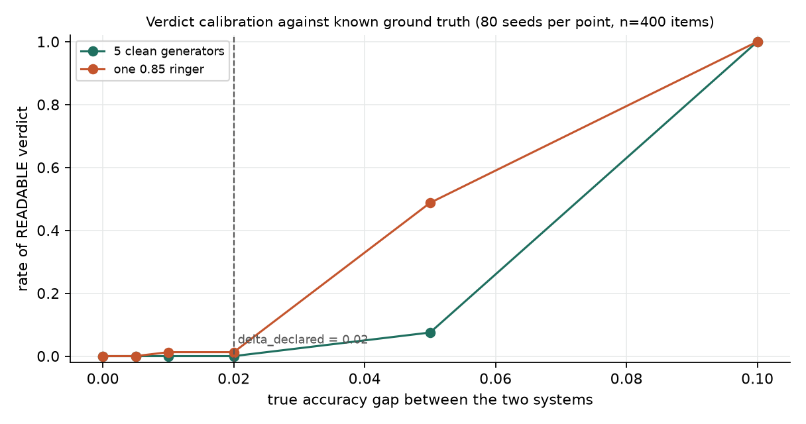

# arx

**An autonomous research loop that will not write a claim it cannot support.**

`arx` reads literature, proposes hypotheses, runs experiments in a sandbox, and
reports findings — but only after a statistical gate decides the measurement
could actually resolve the thing being claimed.

[](https://github.com/aidless/arx/actions/workflows/ci.yml)

```
pytest: 374 passed, 0 skipped (Linux, Python 3.12)   |   ruff: clean   |   examples: 6, all runnable offline
```

## The one-sentence version

A leaderboard's rank difference is readable only if it exceeds the noise
floor of the labels it was measured against — and most of them don't.

> Pipeline context: arx is the research-loop layer of the three-layer eval
> pipeline; the verdict layer's frozen demo suite is benchmark-verified:
> [eval-gate docs/BENCHMARK.md](https://github.com/aidless/eval-gate/blob/main/docs/BENCHMARK.md).

## Install and run

```bash
# from a checkout
git clone https://github.com/aidless/arx && cd arx
python3 -m pip install -r requirements.lock && python3 -m pip install -e . --no-deps
python3 examples/01_quick_run.py     # no API key, no network, no model
python3 -m pytest tests -q           # 374 passed (pinned dev+provenance lock)

# or one command: install + tests + demo + both measurements
make repro

# or install the package straight from GitHub
python3 -m pip install "git+https://github.com/aidless/arx.git"
arx --help
```

## 60-second demo

No API key, no network, no model:

```bash
git clone https://github.com/aidless/arx && cd arx
make quickstart
```



`make quickstart` runs the leaderboard audit example. The GIF shows the same
verdicts with the numbers that produced them: one readable board, three
undecidable ones for different reasons, and one marginal result that is inside
the resolution bound. `make demo` is the separate browser demo.

The examples are the fastest way to see what the gate does. Each one runs
offline, in a few seconds, and prints the numbers its own code produced.

`examples/02_audit_a_leaderboard.py` prints the verdicts with the numbers that
produced them. Two excerpts:

```text
  five generators agreeing only by chance
    verdict  : UNDECIDABLE
    reason   : floor_degenerate
    floor (0.4640) is at or below the chance level (0.5000);
    no sample size makes it informative

Unpaired vs paired resolution: read mde_method
  without per-item scores : mde=0.0274 (binomial_approx)  -> READABLE
  with per-item scores    : mde=0.0743 (cluster_bootstrap)  -> MARGINAL
```

Same board, same generators, same items. The verdict moved because the
resolution method moved — which is why `mde_method` is always in the report.

The `arx` command lands wherever pip puts user scripts. On this machine that is
`~/.local/bin`, which is often not on `PATH`, so either add it or call the CLI as
a module:

```bash
export PATH="$HOME/.local/bin:$PATH"    # if pip installed to user site
arx --help
# or, no PATH change needed:
python3 -m arx.cli --help
```

Python 3.12+ is the only supported version and the only one required — the core
package imports nothing beyond `numpy` and the standard library.

## Demo

[Live demo](https://aidless.github.io/arx/) · [Demo docs](demo/README.md)

Eight synthetic audit cases run through `audit_leaderboard` at build time; the
gallery shows the four verdicts and the exact refusal reasons. It also includes
a nested-sample sensitivity grid and the real ChaosNLI human-vs-LLM-floor case.

```bash
python3 demo/server.py                  # http://127.0.0.1:8000/
python3 -m unittest demo/test_demo.py -v
```

## Audit a leaderboard

```bash
arx audit board.json --delta 0.02
arx audit board.json --delta 0.02 --html report.html
```

`board.json` needs `votes` (generators × items), `scores` (system → score), and
optionally `judge_ids`, `contestant_ids`, `item_ids`, `floor_item_ids`. The
`--html` report is a single self-contained file: the verdict, the floor, the
margin, the resolution bound, and the reason each refusal fired. No network, no
model, no JavaScript. A hostile leaderboard name is escaped, not rendered.

`examples/06_audit_report.py` writes a demo report to `examples/_out/`.

## What the gate refuses

Every scientific claim in a report has to clear four checks. Each check is a
**reason to refuse**, and refusing is the tool working:

| tenet | refuses when | verdict |
|---|---|---|
| **actor-disjointness** | the gold producers are also the contestants | `UNDECIDABLE` |
| **common denominator** | floor and board computed on different item sets | `UNDECIDABLE` |
| **multi-generator** | fewer than three gold producers | `UNDECIDABLE` |
| **power-bounded** | margin is smaller than the MDE at declared power | `MARGINAL` |

Plus a fifth, quieter check that runs first: **is the floor above chance at
all?** Five generators who each flip a coin agree with each other half the time,
so their floor sits near 0.5 — and any score above that looks like a landslide.
If the floor is not detectably above the chance rate, there is no gold to
measure against, and the verdict is `UNDECIDABLE` no matter how large the
margin.

`UNDECIDABLE` is not a polite `MARGINAL`. It says the question was not asked in
a way that permits an answer. `MARGINAL` says the answer is "smaller than we can
tell". The difference matters, because the fix is different: one needs a new
design, the other needs more items.

## Why this exists

The claim-gate separation is the whole point. A system that proposes
hypotheses, runs experiments, and judges its own results will optimise the
appearance of progress — the same failure mode it is supposed to detect. Three
design decisions keep that from happening:

1. **The gate is a check on the apparatus, not the number.** It never asks "is
   this effect big enough". It asks "can this measurement resolve this
   comparison", which is a question about the design.

2. **Ordering, not policy, closes look-laundering.** `k_max` is decided and
   written to the ledger *before* the experiment runs. No policy can prevent
   "run a fixed-sample test, miss, then claim you only intended one look" — the
   enforcement would have to be done by the party that wants to break it. The
   ordering makes the claim impossible rather than forbidden.

3. **The scheduler is not fitted to the run it judges.** `expected_information_
   gain` is a hand-written heuristic over a few coarse features. A learned
   scheduler cannot be verified by the audit it schedules, and a fitted one is
   a Goodhart target: optimise it and you optimise for appearances.

## What is new here

Not the statistics — leave-one-out floors, Dawid-Skene, the four tenets are
classical measurement theory. Not the loop either. The contribution is putting
a gate in front of an *agent that generates its own hypotheses*, which is what
makes the classical tools necessary rather than optional:

- **The refusal taxonomy is complete and explicit.** `READABLE` / `MARGINAL` /
  `UNREADABLE` / `UNDECIDABLE` are the four distinct failure modes, and the
  documentation says which one you are in and why. A system that only returns
  "significant" is a system that cannot tell you it failed.
- **Ordering enforces the pre-registration.** The script hash pinned before the
  run, read off the file after; `k_max` from the ledger, never from the
  experiment's self-report.
- **`mde_method` is always in the report.** `binomial_approx` and
  `cluster_bootstrap` disagree by ~2.7× on the same board. A resolution bound
  that quietly answers a different question is the failure this package exists
  to make visible.

## Measured, not asserted

Two simulations with known ground truth, both offline and both regenerated by
`make measure` (`scripts/measure_floor_calibration.py` and
`scripts/measure_verdict_calibration.py`). Raw output is committed under
[`docs/measurements/`](docs/measurements/).

**1. Is the floor estimate calibrated?** 5 generators, 400 items, every
generator's true accuracy fixed at 0.93, 200 seeds. True floor = 0.93.

| estimator | mean estimate | bias | sd | mean abs error |
|---|---|---|---|---|
| `loo` (shipped) | 0.9183 | **−0.0117** | 0.0083 | 0.0123 |
| `mean` (all-generator consensus) | 0.9308 | +0.0008 | 0.0057 | 0.0045 |
| `optimistic` (best single generator) | 0.9447 | +0.0147 | 0.0080 | 0.0148 |

The shipped leave-one-out floor sits **1.2 pp below** the true floor. That
direction matters: `margin = leader_score − floor_estimate`, so a floor that is
too low *inflates* the margin and makes `READABLE` slightly easier to reach.
The naive all-generator consensus is better calibrated here, but only because
this simulation makes all five generators equally accurate — the assumption a
real leaderboard violates.



**2. Does the verdict track a known gap?** Two systems with a controlled true
accuracy gap, 400 items, 80 seeds per cell:

| true gap | READABLE, 5 clean judges | READABLE, 1 weak (0.85) judge |
|---|---|---|
| 0.000 | 0.0 | 0.0 |
| 0.020 (= delta_declared) | 0.0 | 0.013 |
| 0.050 | 0.075 | **0.488** |
| 0.100 | 1.0 | 1.0 |



The second column is the finding worth knowing before you trust a verdict: at a
true 5-point gap, adding **one** 0.85-accuracy generator to the judge pool
raises the READABLE rate from 7.5% to 48.8%, because that generator drags the
estimated floor from 0.9235 to 0.9010. The gate rejects boards below chance
(`floor_vs_chance`), but it does not currently penalise a *dispersion* of judge
quality. Treat a heterogeneous judge pool as a reason to read the per-generator
floors in `report.extra["per_generator_floor"]` yourself.

What these numbers do **not** show: how the gate behaves on real leaderboards
with correlated judges and non-iid items. The simulation isolates two variables;
it does not stand in for a field study.

## What it does not do

- **It does not generate a good hypothesis.** `HYPOTHESIZE` is a call to an
  LLM with the literature in context. The gate decides whether the hypothesis
  was *measured*, not whether it was *good*.
- **It does not certify a result, only the measurement.** A `READABLE` verdict
  says the margin cleared the floor by more than the apparatus can resolve. It
  does not say the effect is real, nor that the apparatus measured the right
  thing.
- **It does not fix a bad design.** `UNDECIDABLE` sends the loop back to
  `HYPOTHESIZE`. It will not add generators, fix denominators, or guess what
  you meant.
- **No claim survives contact with an unfalsifiable statement.** `arx theory`
  reports coverage — how many tested hypotheses could constrain a theory at
  all. A high number with weak theories is still weak science, and the report
  says so.

## Documentation

| document | what it covers |
|---|---|
| [docs/architecture.md](docs/architecture.md) | the loop, the five modules, the experiment contract |
| [docs/evaluation-gate.md](docs/evaluation-gate.md) | the four tenets, the floor, the MDE, worked example |
| [docs/sequential-gate.md](docs/sequential-gate.md) | why the naive boundary triples the error rate |
| [docs/ledger.md](docs/ledger.md) | what the hash chain proves, and what it does not |

## Status

The statistical core and the loop are complete and tested (373 tests: 370
passing, 3 skipped; ruff clean; Python 3.12). The literature and Zotero integrations are implemented but
have not been exercised against live services — `arx doctor` reports what your
install can actually do. The RL/Goodhart demonstration (`arx.rl.goodhart_env`) is a bandit with
judge noise, not a research result.

**This is not a general-purpose AGI system and does not claim to be.** It is a
loop that refuses to write a claim it cannot support, and every refusal is
recorded in a ledger you can verify.

## License

Apache-2.0.
